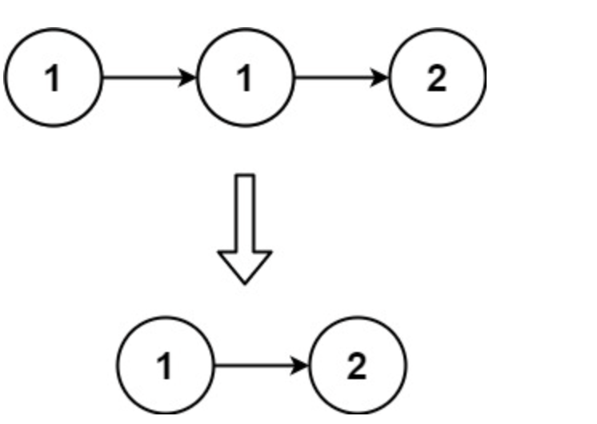
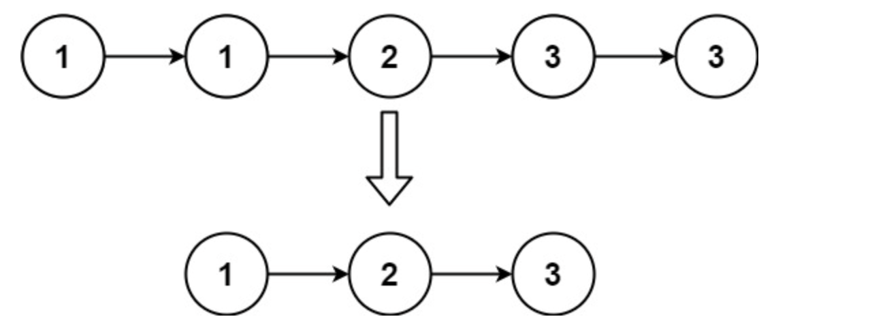

# 83. Remove Duplicates from Sorted List
> Sorted linked list se duplicates hatao — har value sirf ek baar rahe

| Pattern | Data structure | Time | Space |
|---|---|---|---|
| [Two Pointers – read/write on a list](two_pointers.md) | Singly linked list, 2 node pointers | O(n) | O(1) |

**How it works**
- **Soch:** List sorted hai to duplicates hamesha consecutive hote hain. `i` = last unique node (write side), `j` = scan node (read side). `j` ki value `i` jaisi → `j` ko list se bypass kar do.
- **Skip:** `i->val == j->val` → `i->next = j->next` (duplicate unlink, `i` wahi rukta hai).
- **Advance:** nayi value → `i = i->next` (jo ab `j` hi hai). Har step `j = j->next`.
- **Kyun sahi hai:** Invariant: head se `i` tak saari values unique hain aur `i->next == j` hamesha. Har node ek baar dekha → O(n), O(1).
- **Dry run:** `[1,1,2]`
  - `i=1`, `j=1` (dup) → `i->next = 2`
  - `j=2`: nayi value → `i=2`
  - `j=NULL` → `[1,2]` ✔

**Gotcha:** Unlink kiye duplicate nodes kabhi `free` nahi hote → real code mein memory leak (LeetCode pe chalta hai). `if(!head)` check zaroori, warna `head->next` NULL deref.
**vs related:** [26](<../../Arrays/Two_Pointers/26. Remove Duplicates from Sorted Array.md>) mein same read/write idea array pe hai — wahan value copy karte the, yahan `next` pointer re-link karte hain.

<details><summary>Problem statement</summary>

Given the head of a sorted linked list, delete all duplicates such that each element appears only once. Return the linked list sorted as well.

Example 1:



Input: head = [1,1,2]
Output: [1,2]


Example 2:




Input: head = [1,1,2,3,3]
Output: [1,2,3]

</details>

## Code

```c
/**
 * Definition for singly-linked list.
 * struct ListNode {
 *     int val;
 *     struct ListNode *next;
 * };
 */

typedef struct ListNode Node;
struct ListNode* deleteDuplicates(struct ListNode* head) 
{
    if(!head) return head;  // empty list → head->next NULL deref se bacho
    Node * i = head;  // i = last unique node (write side)
    Node * j = head->next;  // j = scan pointer (read side)

    while(j)
    {
        if(i->val == j->val)  // sorted → duplicate hamesha i ke just baad
            i->next=j->next;  // dup ko unlink (free nahi hota → leak)
        else 
            i=i->next;  // nayi value → i aage, ab yahi last unique
        j=j->next;  // har step read pointer aage
    }
return head;
}
```
