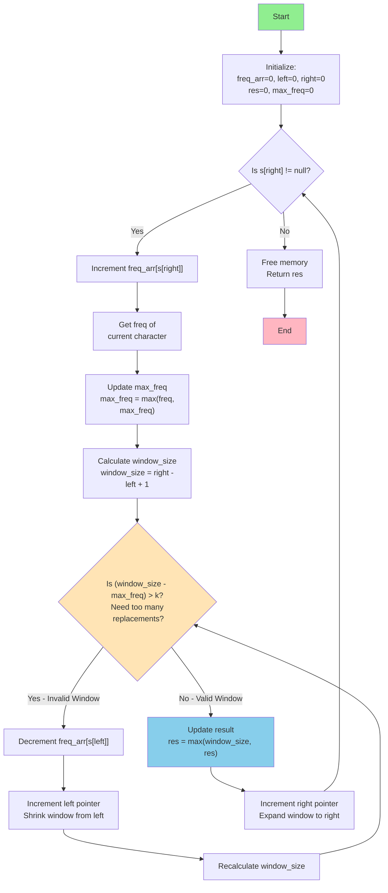

# 424. Longest Repeating Character Replacement
> Uppercase string mein at most `k` characters badal ke sabse lambi same-letter substring ki length do

| Pattern | Data structure | Time | Space |
|---|---|---|---|
| [Sliding window – `window - max_freq ≤ k`, maximize](sliding_window.md) | `freq_arr[26]` (calloc) + `max_freq_in_window` | O(n) | O(1) (26 ints) |

**How it works**
- **Soch:** Window ko ek hi letter banana hai to sabse frequent char rakho, baaki sab badlo → replacements = `window_size - max_freq`. Ye `≤ k` ho to window valid. Sabse lambi valid window chahiye → variable window, maximize.
- **Expand:** `s[right]` ka freq++, aur `max_freq_in_window` ko us char ke naye freq se update (sirf yahi char naya max bana sakta hai).
- **Shrink:** `window_size - max_freq_in_window > k` → `s[left]` ka freq--, `left++`. `max_freq_in_window` ko wapas kam **nahi** karte.
- **Kyun sahi hai:** Window size kabhi kam nahi hoti (shrink loop max 1 baar chalta hai). Ek baar `window = max_freq + k` ho gayi, to aage badhne ke liye `max_freq` ka naya high chahiye — stale (purane) `max_freq` pe window bas same size pe slide karti hai, isliye `res` kabhi galat bada nahi hota. Har step O(1) → O(n).
- **Dry run:** `"AABABBA", k=1`
  - `r=3` (`AABA`): A=3 → `4-3=1 ≤ 1` → res 4
  - `r=4` (`B`): `5-3=2 > 1` → shrink, window `ABAB` (size 4)
  - `r=5, 6`: max_freq 3 stale, window size 4 pe slide karti hai → res 4 ✔

**Gotcha:** Shrink pe `max_freq_in_window` kam na karna bug nahi, trick hai (upar dekho) — sahi max nikaalne ke liye 26-scan nahi karna padta. `s[x]-'A'` sirf uppercase input pe safe hai.
**vs related:** [K Uniques](<Longest Substring with K Uniques.md>) mein window ka constraint distinct count tha; yahan "kitne chars badalne padenge" (`window - max_freq`). [1004. Max Consecutive Ones III](<../../Arrays/Sliding_Window/1004. Max Consecutive Ones III.md>) iska binary version hai: sirf 0 badalne hain → `zeros ≤ k`.

<details><summary>Problem statement</summary>

You are given a string s and an integer k. You can choose any character of the string and change it to any other uppercase English character. You can perform this operation at most k times.

Return the length of the longest substring containing the same letter you can get after performing the above operations.

 

Example 1:

Input: s = "ABAB", k = 2
Output: 4
Explanation: Replace the two 'A's with two 'B's or vice versa.
Example 2:

Input: s = "AABABBA", k = 1
Output: 4
Explanation: Replace the one 'A' in the middle with 'B' and form "AABBBBA".
The substring "BBBB" has the longest repeating letters, which is 4.
There may exists other ways to achieve this answer too.

</details>

## Code

```c
int characterReplacement(char* s, int k) {
    int * freq_arr =calloc(sizeof(int), 26);  // window ka freq A–Z (calloc args ulte hain, par total size same → OK)
    int left =0, right=0;

    int res=0, max_freq_in_window=0;

    while(s[right] != '\0')
    {
        int current_element_freq=0,window_size=right-left+1;  // window [left..right], s[right] include karke

        freq_arr[(unsigned char)s[right]-'A']++;  // expand: s[right] window mein
        current_element_freq=freq_arr[(unsigned char)s[right]-'A'];
        max_freq_in_window=current_element_freq>max_freq_in_window?current_element_freq:max_freq_in_window;  // recalculate: sirf s[right] hi naya max bana sakta hai
        
        while((window_size-max_freq_in_window)>k)  // replacements > k → window invalid → shrink
        {
            // max_freq yahan kam NAHI karte: stale max pe window bas slide karti hai
            freq_arr[(unsigned char)s[left]-'A']--;  // shrink: s[left] window se bahar
            left++;
            window_size=right-left+1;
        }
        res = window_size > res ? window_size : res;  // record answer (stale max pe size res se aage nahi badhta)
        right++;

    }
    free(freq_arr);
    return res;
}
```

```c
Even though current window after reducing window size does not meet the requirement, we still proceed to procees right when window - 
max_freq meets requirement coz it will never result in changing the res, as it will only be updated when we find a element in a window 
that will result in changignd the max_freq as it will lead to change is res
```


